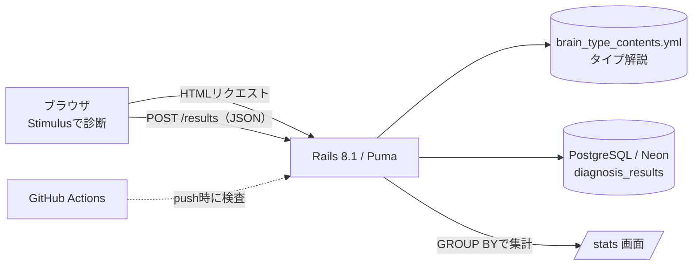
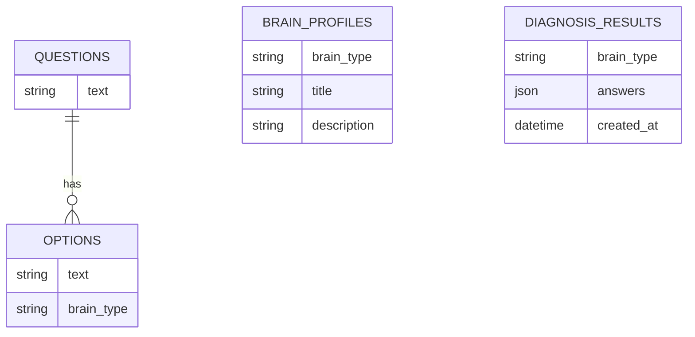
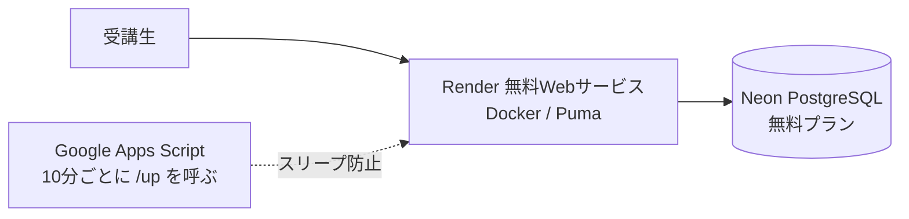

# 君の脳 (Kiminonoha) — 脳タイプ診断

7つの質問に答えると、思考・行動スタイルを4つの動物タイプ（チーター・フクロウ・ゾウ・イルカ）で教えてくれる、無料の診断Webアプリです。

## 概要

- 質問に答えると脳タイプが表示され、学び方・仕事の進め方・人との関わり方のヒントを読めます。
- 結果画面では、誕生日パーティー風のお祝い演出（クラッカー・紙吹雪・風船）が出ます。
- 結果の画像を作って、X・Instagram・LINE・Facebook でシェアできます。
- 会員登録は不要です。同意した場合だけ、結果を**匿名**で保存し、みんなの傾向を集計して表示します。

## 作った目的

- RUNTEQ の受講生・修了生に向けて、SNSで共有できる**ポートフォリオ**として作りました。
- 「作って終わり」にせず、**データを集めて学習のヒントに活かす**流れ（収集 → 集計 → 活用）を、小さな規模で形にすることを目指しました。
- 現在は広告・収益化は行っていません。

## 技術スタック

| 分類 | 内容 |
|---|---|
| 言語 / フレームワーク | Ruby 3.4.7 / Rails 8.1 |
| フロントエンド | Hotwire（Turbo + Stimulus）、Tailwind CSS 4、esbuild |
| データベース | PostgreSQL（開発: Docker 16 / 本番: Neon 無料プラン） |
| サーバー | Puma（本番: Render 無料Webサービス + Docker） |
| テスト・品質 | Minitest（47件）、RuboCop、Brakeman、bundler-audit |
| CI | GitHub Actions（セキュリティスキャン → Lint → テスト） |

## 主なページ

| パス | 内容 |
|---|---|
| `/` | 脳タイプ診断（開始 → 質問 → 分析 → 結果） |
| `/types`, `/types/:id` | 4タイプの一覧と詳しい解説 |
| `/guide` | 診断の仕組みと使い方 |
| `/stats` | 匿名の集計（タイプ分布・学び方のヒント）。5件未満は非公開 |
| `/privacy` | 保存する情報・しない情報のお知らせ |
| `POST /results` | 診断結果の保存（JSON API） |

## セットアップ

```bash
# 1. DBを起動（Docker。ホスト側のポートは5433）
docker compose up -d db

# 2. 依存関係のインストールとDBの準備
bundle install
npm install
export DB_HOST=127.0.0.1 DB_PORT=5433
bin/rails db:prepare db:seed

# 3. 開発サーバー（Rails + JS/CSSの監視）
bin/dev
```

起動後は http://localhost:3000 を開きます。

## テスト

```bash
DB_HOST=127.0.0.1 DB_PORT=5433 bin/rails test   # テスト
bin/rubocop                                      # Lint
bin/brakeman --no-pager                          # セキュリティスキャン
bundle exec bundle-audit check --update          # 依存パッケージの脆弱性チェック
```

## アーキテクチャ



- **画面はサーバー側で描画（ERB）+ Stimulus**：ページごとのタイトル・説明・OGPがサーバーで完成するため、SNSのプレビューに向いています。
- **診断の計算はブラウザ側**：結果だけをサーバーに送るので、サーバーの負荷が小さくなります。
- **タイプの解説文はDBではなくYAML**：頻繁に変わらず、レビューやバージョン管理がしやすいためです。

## データ設計



- `diagnosis_results` は**匿名**です。名前・メールアドレス・IPアドレス・端末情報は保存しません。
- `answers` は7問ぶんの回答タイプの配列で、モデルで件数と値を検証します。
- 集計は件数が少ないと個人を推測できるため、**5件未満では表示しません**。

## 設計判断

| 判断 | 理由 |
|---|---|
| 集計への協力は任意（初期値オン）、外すとサーバーへ送信しない | データ収集について、利用者が選べるようにするため |
| グループ分けやフィードバック機能は作らない | 集める項目を最小限にし、説明できる範囲だけにするため |
| シェア用の結果画像をブラウザ（canvas）で生成 | サーバーの負担なしに、タイプ名とキャラクター入りの画像を作れるため |
| スマホはWeb Share API、PCはSNSごとに分岐 | PCの共有シートにはSNSアプリが出ないため。X は画像をコピーして貼り付け、LINE・Facebook はリンクのプレビュー画像（OGP）で見せる |
| SNSの公式ロゴは使わず文字のボタンにする | 各SNSのロゴ使用ガイドラインを避けるため |
| DBを MySQL から PostgreSQL へ変更 | 無料で使える Neon が PostgreSQL のため |
| Rails 7.2 → 8.1、Ruby 3.2 → 3.4 | 既知の脆弱性（Critical/High を含む）の解消と、サポート終了への対応のため。CIの失敗も同時に解消 |
| 本番用 `Dockerfile.render` を開発用と分離 | 本番はビルド時にアセットを事前コンパイルする必要があるため |
| 起動スクリプトは「データが空のときだけ」シードを実行 | `db/seeds.rb` は既存データを消して作り直すため、再起動のたびには実行できない |
| トップ画像を 7MB から約300KBへ圧縮 | スマホの初回表示を軽くするため |

## デプロイ（Render + Neon、無料）



- 設定ファイル：`render.yaml`（Renderのブループリント）、`Dockerfile.render`（本番用イメージ）、`bin/render-start`（マイグレーション → 初期データ投入 → サーバー起動）
- 限定公開のため、`NOINDEX=true` で検索エンジンには載せません（SNSのプレビュー用クローラーは弾かないよう、robots.txt は全体許可のままです）。
- 手順：Neon でプロジェクトを作成（Singapore）→ Render の Blueprint からこのリポジトリを選択 → 環境変数 `DATABASE_URL` に Neon の **Direct connection**（`-pooler` なし）を設定。

無料のWebサービスは15分アクセスがないとスリープするため、Google Apps Script で定期的に起こします。

```javascript
// Renderの無料サービスがスリープしないよう、10分ごとにヘルスチェックを呼ぶ
function keepAlive() {
  UrlFetchApp.fetch("https://<サービス名>.onrender.com/up", { muteHttpExceptions: true });
}
```

## 今後の課題

- トップのメインビジュアルを、自作の画像に差し替える（公開前に必須）。
- `config.hosts` の設定と CSP（Content Security Policy）の導入。
- 診断の流れ（JavaScript）のE2Eテストの追加。
- まだデプロイ前のため、実際の利用データはありません。公開後に実測値を追記する予定です。
