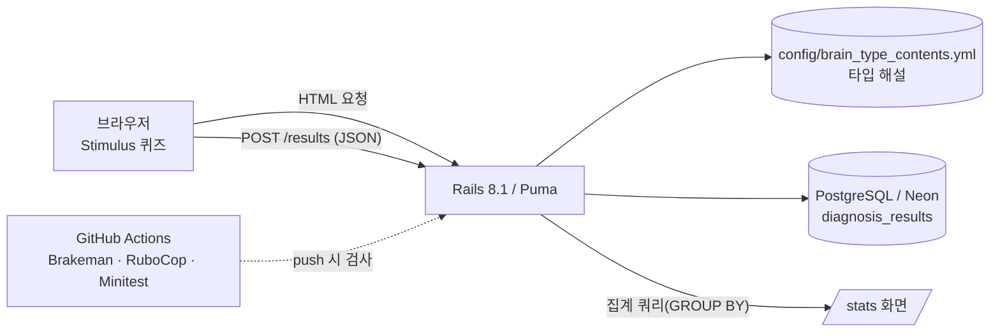
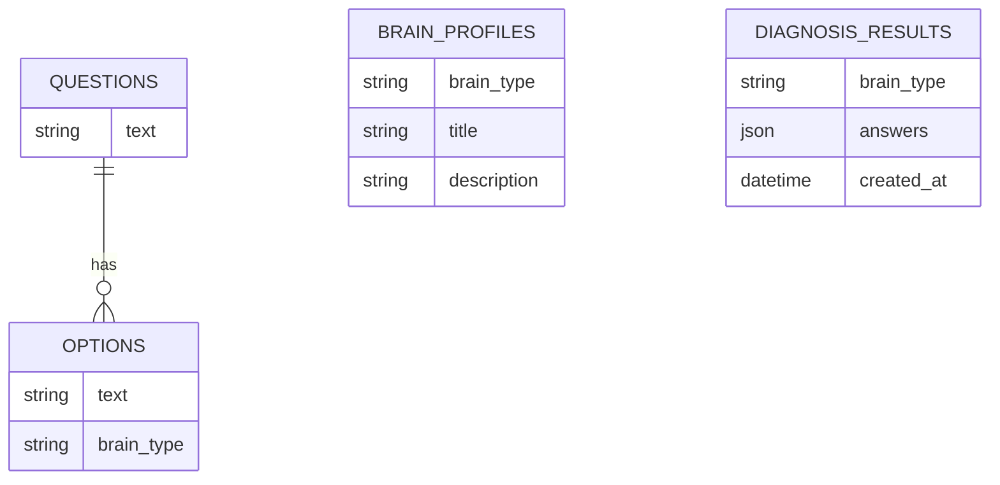
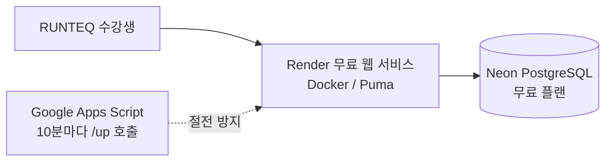

# 君の脳 (Kiminonoha) — 뇌 타입 진단

> 7개의 질문으로 나의 사고·행동 스타일을 4가지 동물 타입(치타·부엉이·코끼리·돌고래)으로 알려 주는 무료 진단 웹앱입니다.

## 1. 서비스 개요

- 질문 7개에 답하면 뇌 타입이 표시되고, 학습법·업무법·인간관계 팁을 확인할 수 있습니다.
- 결과 화면에서는 생일 파티 같은 축하 애니메이션(폭죽·색종이·풍선)이 나옵니다.
- 회원가입 없이 사용할 수 있습니다. 동의한 경우에만 결과를 **익명**으로 서버에 저장하고, 집계를 통해 학습 팁을 보여 줍니다.
- 결과가 들어간 **이미지**를 만들어 X·Instagram·LINE·Facebook으로 공유하거나 저장할 수 있습니다.

## 2. 목적

- RUNTEQ(ランテック) 수강생·수료생 커뮤니티에 **SNS로 공유**하기 위한 포트폴리오 겸 가벼운 진단 서비스입니다.
- 현재는 광고·수익화 없이 운영합니다.

## 3. 기술 스펙

| 구분 | 내용 |
|---|---|
| 언어 / 프레임워크 | Ruby 3.4.7 / Rails 8.1 |
| 프런트엔드 | Hotwire (Turbo + Stimulus), Tailwind CSS 4, esbuild |
| DB | PostgreSQL (개발: Docker 16 / 배포: Neon 무료 플랜) |
| 서버 | Puma (개발: Docker Compose / 배포: Render 무료 웹 서비스) |
| 테스트 | Minitest (컨트롤러·모델), Brakeman, RuboCop |
| CI | GitHub Actions (보안 스캔 → 린트 → 테스트, PostgreSQL 서비스 사용) |

## 4. 주요 페이지

| 경로 | 내용 |
|---|---|
| `/` | 뇌 타입 진단 (시작 → 질문 → 분석 → 결과) |
| `/types`, `/types/:id` | 4가지 타입 목록과 상세 해설 |
| `/guide` | 진단 방식과 활용법 |
| `/stats` | 익명 집계(타입 분포·학습 팁). 5건 미만이면 비공개 |
| `/privacy` | 어떤 데이터를 저장하고 저장하지 않는지 안내 |
| `POST /results` | 결과 저장(JSON API) |
| `/sitemap.xml`, `/robots.txt` | 검색 엔진용 |

## 5. 실행 방법

```bash
# 1. DB 실행 (Docker, 호스트 포트 5433)
docker compose up -d db

# 2. 의존성 설치와 DB 준비
bundle install
npm install
export DB_HOST=127.0.0.1 DB_PORT=5433
bin/rails db:prepare db:seed

# 3. 개발 서버 (Rails + JS/CSS 감시)
bin/dev
```

개발 서버 기본 주소는 `http://localhost:3000` 입니다.

## 6. 테스트

```bash
DB_HOST=127.0.0.1 DB_PORT=5433 bin/rails test   # 테스트
bin/rubocop                        # 린트
bin/brakeman --no-pager            # 보안 스캔
```

## 7. 아키텍처



- **화면은 서버 렌더링(ERB) + Stimulus**: 페이지마다 제목·설명·OGP가 서버에서 완성되어 SNS 미리보기와 검색에 유리합니다.
- **퀴즈는 브라우저에서 계산**하고, 결과만 서버에 보냅니다. 서버 부하가 작고 오프라인 상태에서도 결과 계산이 가능합니다.
- **해설 문장은 DB가 아닌 YAML**: 자주 바뀌지 않고, 코드 리뷰와 버전 관리가 쉽기 때문입니다.

## 8. 데이터 설계



- `diagnosis_results`는 **익명**입니다. 이름·이메일·IP·기기 정보를 저장하지 않습니다.
- `answers`는 질문 7개의 답변 타입 배열이며, 모델에서 길이와 값을 검증합니다.
- 인덱스: `brain_type`(집계용). 연번 ID나 개인 식별자는 외부에 노출하지 않습니다.

## 9. 설계 결정과 이유

| 결정 | 이유 |
|---|---|
| 5건 미만이면 집계를 숨김 | 적은 인원에서 개인이 추측되는 것을 막기 위해 |
| 동의 체크박스(기본 ON), 해제 시 서버 전송 없음 | 데이터 수집에 대한 선택권을 주기 위해 |
| 저장 API에 `rate_limit` 적용 | 연타·악용으로 통계가 오염되는 것을 줄이기 위해 |
| 공유할 때 **결과 이미지**를 브라우저(canvas)에서 생성 | 서버 부담 없이 타입 이름·캐릭터가 들어간 이미지를 바로 공유할 수 있어서 |
| 모바일은 Web Share API로 이미지 파일 공유 | 앱 선택창에서 X·Instagram·LINE 등으로 이미지를 바로 보낼 수 있어서 |
| 공유 링크는 타입 해설 페이지(타입별 결과 이미지 OGP) | PC에서도 X·LINE·Facebook 링크 미리보기에 결과 이미지가 표시되도록 |
| PC는 OS 공유 창을 쓰지 않음 | macOS 공유 창에는 SNS 앱이 나오지 않아서. 터치 기기에서만 Web Share 사용 |
| 공유 버튼은 공식 로고 없이 문자 라벨 | 각 SNS의 로고 사용 가이드라인을 피하기 위해 |
| Instagram(PC)은 이미지 저장 + 문구 복사 후 사이트 열기 | 웹용 공유 URL이 없기 때문 |
| 그룹 구분·피드백 기능은 두지 않음 | 수집 항목을 최소화하고 설명할 수 있는 범위만 남기기 위해 |
| DB를 MySQL에서 PostgreSQL로 변경 | 무료로 쓸 수 있는 Neon이 PostgreSQL이라서. 마이그레이션은 DB 비의존이라 코드 변경은 설정 수준으로 끝났음 |
| 운영용 `Dockerfile.render`를 개발용과 분리 | 개발용은 볼륨 마운트 전제이고, 운영은 빌드 시점에 에셋을 미리 컴파일해야 해서 |
| 시작 스크립트에서 "데이터가 비었을 때만" 시드 실행 | `db/seeds.rb`는 기존 데이터를 지우고 다시 만들기 때문에 재시작마다 돌리면 안 되어서 |
| minitest 5계열로 고정 | Rails는 minitest 6과 호환되지 않기 때문(CI 실패의 원인이었음) |
| Ruby 3.2 → 3.4, CI의 Ruby는 `3.4`(최신 패치) | GitHub Actions의 `ubuntu-latest`가 Ubuntu 26으로 바뀌면서 3.2.5가 제공되지 않아 CI가 실패했고, 3.2는 지원도 종료되어서 |
| Rails 7.2 → 8.1 업그레이드 | 7.2에는 알려진 취약점이 다수(bundler-audit)였고 지원도 종료되어서. 업그레이드 후 취약점 0건 |
| 메인 이미지를 7MB → 약 300KB로 압축 | 모바일 첫 화면 로딩 시간을 줄이기 위해 |

## 10. 배포 (Render + Neon, 무료)



- **설정 파일**: `render.yaml`(Render 블루프린트), `Dockerfile.render`(운영용 이미지), `bin/render-start`(시작 스크립트: 마이그레이션 → 초기 데이터 투입 → 서버 시작).
- **공개 범위**: 런텍 수강생에게만 링크로 공유합니다. `NOINDEX=true`로 검색 엔진에는 노출하지 않습니다(링크 미리보기 크롤러는 막지 않기 위해 robots.txt는 전체 허용).

### 배포 순서
1. **Neon**: 프로젝트 생성(리전: Singapore) → *Connection string* 중 **Direct connection**(풀러 `-pooler`가 붙지 않은 것)을 복사합니다.
2. **Render**: *New → Blueprint*에서 이 저장소를 선택하고, 환경변수 `DATABASE_URL`에 위 문자열을 직접 입력합니다. (`SECRET_KEY_BASE`는 자동 생성됩니다.)
3. 배포가 끝나면 `https://<서비스명>.onrender.com/up`이 200을 반환하는지 확인합니다.
4. 링크 미리보기는 X Card Validator 등으로 한 번 확인합니다. (캐시가 남아 있으면 결과 이미지가 바로 안 보일 수 있습니다.)

### 절전 방지 (Google Apps Script)
Render 무료 서비스는 15분 동안 접속이 없으면 잠들어서, 깨어나는 데 30~60초가 걸립니다. 아래 스크립트를 만들고 *트리거 → 시간 기반 → 10분마다*로 실행합니다.

```javascript
// Renderの無料サービスがスリープしないよう、10分ごとにヘルスチェックを呼ぶ
function keepAlive() {
  UrlFetchApp.fetch("https://<サービス名>.onrender.com/up", { muteHttpExceptions: true });
}
```

- 서비스가 1개라면 월 무료 가동 시간(750시간) 안에 들어갑니다. 무료 조건은 바뀔 수 있으니 공식 페이지에서 확인하세요.
- 시간대별로 잠들게 하고 싶다면 트리거 시간대를 제한하면 됩니다.

## 11. 구조 메모

- 타입 해설 문장은 `config/brain_type_contents.yml`에서 관리합니다. `**강조**` 표기는 굵은 글씨로 변환됩니다.
- 질문·결과 데이터는 `db/seeds.rb`에 있습니다. 캐릭터 이미지는 `public/characters/*.svg`(화면용)와 `result-*.png`(SNS 링크 미리보기용 결과 이미지)입니다.
- 결과 계산·저장·결과 이미지 생성·공유·축하 애니메이션은 `app/javascript/controllers/brain_quiz_controller.js` 입니다.

## 12. 배포 전 체크리스트

시니어 엔지니어 관점에서 정리한 항목입니다. (✅ 완료 / ⬜ 배포 전에 해야 함 / 🔶 권장)

### 품질·보안 (확인 결과)
- ✅ 테스트 47건 통과 (입력 검증, 시드 데이터 정합성, 집계 비공개 규칙, 라우팅 제한 포함)
- ✅ `bundler-audit` 취약점 0건 (Rails 7.2 → 8.1 업그레이드로 Critical/High 포함 다수 해결)
- ✅ Brakeman 경고 0건, RuboCop 위반 0건
- ✅ 운영용 Docker 이미지로 부팅·마이그레이션·시드·저장까지 확인 (CSRF 없는 POST는 422로 거부)
- ✅ 보안 헤더 확인: `X-Frame-Options`, `X-Content-Type-Options`, `Referrer-Policy`, HSTS
- ✅ 개인정보: 이름·이메일·IP를 저장하지 않고, 5건 미만이면 집계를 숨김

### 배포 전에 반드시 (블로커)
- ⬜ **메인 비주얼 교체**: 기존 애니메이션 포스터와 매우 비슷해 저작권 위험이 있음. 교체할 파일은 사용 중인 `app/assets/images/main-visual.jpg`이고, 원본 `main-visual.jpg.png`(7MB)도 함께 삭제
- ⬜ Neon **Direct connection** 문자열을 Render의 `DATABASE_URL`에 설정 (저장소·채팅에 올리지 않기)
- ⬜ 푸시 후 GitHub Actions(CI) 통과 확인
- ⬜ 배포 직후 스모크 테스트: `/up` → 진단 1회 → `/stats` 건수 증가 → 링크 미리보기(OGP) 확인

### 권장 (공개 범위를 넓히기 전에)
- 🔶 **`config.hosts` 설정**: 지금은 어떤 Host 헤더도 받아서 OGP 절대 URL이 조작될 수 있음. `RENDER_EXTERNAL_HOSTNAME`만 허용하되 `/up`은 제외(`host_authorization.exclude`). Render에서 직접 확인해야 하므로 배포 후 적용
- 🔶 **CSP(Content Security Policy)**: 현재 미설정. 결과 화면이 `innerHTML` 템플릿을 쓰고 Google Fonts를 불러오므로 허용 목록과 함께 도입
- 🔶 **`innerHTML` 이스케이프**: 현재 데이터는 자체 시드뿐이라 위험이 낮지만, 관리 화면이나 사용자 입력을 도입하면 반드시 이스케이프
- 🔶 **Google Fonts**: 방문자 IP가 Google에 전달됨. 프라이버시 문구에 명시하거나 자체 호스팅
- 🔶 **E2E 테스트**: 퀴즈 흐름(JS)은 자동 테스트가 없음. Capybara 시스템 테스트 추가
- 🔶 **결과 이미지(OGP) 최적화**: PNG 4장이 각 약 260KB. 압축하면 미리보기가 더 빨라짐

### 운영 시 알아둘 점
- `rate_limit`은 프로세스 메모리 기반: 재시작하면 초기화되고, 인스턴스가 2개 이상이면 공유되지 않음 (무료 1대 전제)
- 오류 추적·알림이 없음: 당분간 Render 로그로 확인. 필요하면 Sentry 무료 플랜 검토
- 데이터 보존 기간·삭제 정책이 없음: 익명 통계이므로 영향은 작지만 정기 삭제 규칙을 정해 두면 좋음
- 검색 노출: `NOINDEX=true`를 유지. 공개 범위를 넓힐 때는 이 값과 `/privacy` 문구를 함께 점검

## 13. 알려진 과제

- 메인 비주얼(`app/assets/images/main-visual.jpg`, 원본 `main-visual.jpg.png`)이 기존 애니메이션 포스터와 매우 비슷해, **공개 전에 직접 만든 이미지로 교체**해야 합니다.
- 무료 서버는 접속이 없으면 잠들 수 있어 Google Apps Script로 주기적으로 깨우고 있습니다(그래도 재배포 직후 첫 접속은 느릴 수 있음).
- 아직 **배포 전**이라 실제 사용자 데이터는 없습니다. 수치는 배포 후 실제 값을 기록할 예정입니다.
- Neon 무료 플랜은 일정 시간 후 DB가 대기 상태가 되어 첫 쿼리가 약간 느릴 수 있습니다.


핵심 개념 먼저

문제해결은 세 단계로 이루어집니다.

목표 설정: 무엇을 해결하려는가
요소 파악: 문제에 관여하는 모든 것을 나열
구조화: 요소들을 하나의 전체 그림 속에 놓고 관계를 다시 짜기

흔한 실수는 요소를 하나씩 따로 보는 것입니다. "전단지를 돌릴까, 인스타를 할까?" 같은 식으로 도구부터 고르면 전체 그림이 없어서 효과가 흩어집니다.

은파미용실 적용

목표: 지역주민 중 신규고객을 확보하기 위해 미용실을 효율적으로 알린다.

1단계: 요소 나열
구분	요소
사람	지역주민(연령, 성별, 직업), 기존 단골, 경쟁 미용실
우리 자원	원장님 실력, 시술 메뉴, 가격, 위치, 예산, 시간
전달 수단	전단지, 현수막, 네이버 플레이스, 인스타그램, 당근마켓, 지역 맘카페
제약	한정된 예산, 원장님이 직접 홍보할 수 있는 시간
2단계: 전체 구조 속에서 관계 파악

요소들을 따로 보지 않고 고객이 미용실에 오기까지의 흐름으로 엮습니다.

알게 됨 → 관심 → 검색/확인 → 방문 → 재방문 → 추천

그러면 요소들 사이의 관계가 보입니다.

전단지/현수막은 "알게 됨" 단계만 담당합니다. 하지만 관심이 생긴 사람은 이름을 검색하므로, 네이버 플레이스에 사진·후기·가격이 없으면 방문 직전에 이탈합니다.
당근마켓/맘카페는 "알게 됨"과 "신뢰"를 동시에 해결합니다. 이웃의 후기가 광고보다 강하기 때문입니다.
기존 단골은 단순한 매출원이 아니라 "추천" 단계의 홍보 채널입니다. 단골이 지인을 데려오면 그 비용이 거의 0원입니다.
신규 할인 쿠폰은 "관심 → 방문"의 문턱을 낮추는 장치로, 홍보 수단과 연결되어야 효과가 있습니다.
3단계: 관계를 재구성

따로 있던 요소를 하나의 구조로 다시 묶으면 이렇게 됩니다.

단계	하는 일	연결되는 요소
알림	반경 1~2km 주민에게 노출	당근마켓 비즈프로필, 전단지(QR코드 포함)
신뢰	방문 전 확인	네이버 플레이스(사진, 후기, 가격표)
전환	첫 방문 유도	신규 고객 쿠폰(전단지·당근에서 제시)
유지	재방문	단골 카드, 다음 예약 안내
확산	추천	"지인 소개 시 서로 할인"

여기서 핵심은 전단지 QR코드 → 네이버 플레이스 → 쿠폰처럼 도구들이 서로 이어져 한 흐름이 된다는 점입니다.

이 방식의 장점

병목이 보입니다. 전단지를 아무리 뿌려도(알림 단계) 네이버 후기가 3개뿐이면(신뢰 단계) 손님이 오지 않습니다. 이때 해법은 전단지를 더 뿌리는 게 아니라 후기를 늘리는 것입니다. 요소를 따로 봤다면 놓쳤을 판단입니다.

예산 배분이 쉬워집니다. 가장 약한 단계에 먼저 돈과 시간을 쓰면 됩니다.

효과 측정이 가능해집니다. 각 단계에 숫자를 붙이면(전단지 QR 스캔 수, 쿠폰 사용 수, 신규 방문 수) 어디서 새는지 확인할 수 있습니다.

정리

책이 말하는 요지는 "좋은 해결책은 좋은 아이디어 하나가 아니라, 요소들이 서로 맞물리도록 짠 구조에서 나온다"는 것입니다. 은파미용실의 경우, "무엇으로 홍보할까"라는 질문을 "주민이 우리를 알고, 믿고, 오게 만드는 흐름을 어떻게 이을까"로 바꾸는 것이 곧 이 철학의 적용입니다.

원하시면 은파미용실의 실제 상황(예산, 주 고객층, 위치 등)을 알려주세요. 이 구조에 맞춰 구체적인 실행 계획표로 만들어 드리겠습니다.